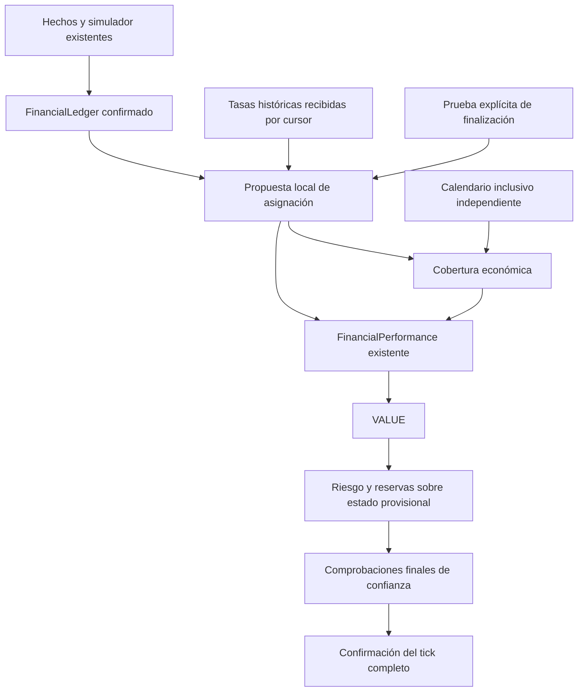

# Funding dinámico causal — diseño 4A-5D4B

Base exacta: cb8c13e21a8ac5f396209d6626279d6c1113b9cf.
Diseño registrado antes de producción en e115710f5660db5ae1baeb1652bb50bb250c02a1.
Implementación opt-in de esta feature; validación y límites en PHASE_4A_5D4B_REPORT.md.
Opt-in de biblioteca, fixtures sintéticos, runtime STOPPED. No autoriza datos reales.

## Decisión de arquitectura

Se extiende ReplayRunner con un componente opcional DynamicFunding. El componente
no calcula PnL: propone FundingEvidence y CoverageEvidence para FinancialPerformance.
FinancialLedger sigue siendo la autoridad de fills, cantidad y ronda. Se conserva
la fórmula existente, sin aplicar un segundo factor 4x. Estrategia, ejecución,
matching, precios modelados, riesgo y reservas conservan sus algoritmos.

La fuente histórica sigue publicando tasas e inventarios, nunca pagos. Se añade
únicamente una consulta de próxima recepción para la agenda: metadatos de una
preparación verificada, sin reconocer valores económicos futuros. Las tasas se
leen por cursor cuando su recepción es <= al reloj. No se precarga una tupla de años.

La implementación debe conservar el orden previo de hechos, entregas del simulador,
cierres de velas, acciones, ledger, eventos financieros y VALUE/riesgo. Los pagos
dinámicos se observan antes de VALUE, después de las entregas estáticas del mismo
instante. La barrera final del tick también debe cubrir riesgo y reservas: si se
pierde confianza, se descarta el estado local completo de ese instante. No implica
atomicidad multihilo ni transacciones con procesos externos.

## FND-5D4-001: agenda y autoridad económica

DynamicFunding recibe HistoricalFundingSource y una política explícita fixture-only.
Necesita FinancialLedger y FinancialPerformance opt-in. No acepta simultáneamente
FundingEvidence o cobertura FUNDING procedentes de la fuente financiera estática:
existirían dos autoridades para el mismo costo. Fees, transferencias y Mark mantienen
sus puertos y orden. Sin componente dinámico, no se añaden campos serializados ni
transiciones; deben conservarse todos los fingerprints de comportamiento legados.

Cada tasa conserva T y su recepción original R_rate. El pago conserva T como
effective_at y solo puede recibirse en R_payment >= max(R_rate, R_reference,
R_finalization, recepción de todos los fills necesarios). No se reescribe VALUE
pasado. Una tasa recibida después de request.end queda sin consumir, nunca se
retimestampa para incluirla en el resultado solicitado.

La agenda incorpora próxima tasa, próximos manifiestos y frontera demostrable del
simulador. Esas fechas dependen de inputs y contratos, nunca de los cortes arbitrarios
de run(until). Por tanto, fragmentar una ejecución no crea recepciones nuevas.

## FND-5D4-003: exposición y finalización

Se reutiliza la reconstrucción histórica de FinancialPerformance: BUY ejecutados
estrictamente antes de T menos SELL ejecutados estrictamente antes de T, en contexto
Decimal del ledger. FillId ordena sumas canónicas, no prioridad económica. Un fill
exactamente en T bloquea; no se inventa prioridad por UUID, recepción o secuencia.
Debe existir a lo sumo una ronda con cantidad positiva en T para LONG/ONE_WAY.
La ronda actualmente activa no interviene en la atribución de una tasa tardía.

Hay dos clases de evidencia de finalización:

1. Manifiesto fixture de ejecución: frontera económica inclusiva, recepción explícita,
   identidad de FactSource y conjunto completo de FillIds de esa frontera. La lista
   es una declaración independiente del fixture; no se fabrica desde los fills que
   casualmente llegaron. Solo se acepta cuando el ledger recibido contiene exactamente
   esos FillIds dentro de la frontera. IDs faltantes mantienen PENDING. IDs adicionales
   contradicen la declaración. No se admiten declaraciones de una fuente distinta.
2. Prueba del simulador aprobado: sus fills se generan con timestamp del cierre
   procesado y tienen delivery_latency_ms explícita. Después de procesar todos los
   cierres <= T y todas sus entregas, y no antes de T + delivery_latency_ms, se
   comprueba igualdad entre fills generados <= T y fills recibidos por el ledger.
   El cursor de minutos, la identidad del simulador y la cola de entregas son parte
   de la justificación. El mero hecho de que clock >= T no es una prueba.

Selección entre manifiestos fixture (AUD-5D4B-001): para cada tasa pendiente en el
instante causal actual se examinan todos los manifiestos recibidos con through >= T.
Cada uno debe corresponder a la FactSource vinculada. Se contrasta su conjunto
completo de FillIds con el ledger confirmado hasta su propia frontera inclusiva.
IDs declarados todavía ausentes dejan ese candidato incompleto; IDs confirmados
no declarados constituyen una contradicción y abortan la propuesta, aunque otro
candidato esté completo. También siguen rechazándose los manifiestos mutuamente
contradictorios al recibirse. Un candidato incompleto no oculta otro completo.
Cada fill nuevo se contrasta también con todos los manifiestos ya recibidos,
incluidos los incompletos o no elegidos: una contradicción posterior no se oculta
por haber finalizado T mediante otra frontera. Se aborta antes de confirmar el fill
y se conserva el snapshot anterior al tick.

Después de validar todos los candidatos, se elige el completo con menor clave
lexicográfica (received_at, through, identity). identity es el digest estable del
manifiesto; no decide prioridad entre fills. La recepción más temprana conserva la
elección anterior cuando no hay empate y ese primer candidato ya estaba completo.
Los empates se resuelven por frontera y después identidad, sin depender del orden
de una colección. No se usa un manifiesto cuya recepción sea posterior al reloj,
ni se finaliza por reloj. Sin candidato completo se conserva PENDING_EXPOSURE.
Se comprueba confianza tras el contraste y antes de entregar la prueba construida.

La elección no revisa decisiones ya finalizadas ni sus IDs. Una decisión pendiente
que antes quedaba bloqueada indebidamente puede ahora producir su primer pago.
Empates que antes dependían del orden incidental adquieren la regla explícita
anterior. Cambiar el contenido u orden de una fuente cambia su binding original;
la regla de selección no promete igualar todos los IDs entre fuentes diferentes.
ReplayRunner mantiene los mismos instantes internos de agenda entre ejecución
continua, fragmentada y restaurada; los cortes externos no crean publicaciones.

Sin ninguna prueba válida, permanece PENDING_EXPOSURE y no hay FundingEvidence.
La finalización también protege NO_EXPOSURE: cualquier FillId nuevo que contradiga
una frontera ya finalizada se detecta antes de confirmar su transición. Se interrumpe
explícitamente, conservando el snapshot previamente válido; no se vuelve a asignar
ni se reescribe un pago o una decisión de exposición cero.

Las declaraciones fixture no son certificados Binance. Deben conservar origen,
disponibilidad, supuestos e identidad. Una declaración posteriormente contradicha
no permite continuar publicando resultados de ese prefijo extendido.

## Referencia y autorización — FND-5D4-004

El opt-in exige SYNTHETIC_FIXTURE_ONLY en política y procedencia FIXTURE en todos
los bindings y tasas originales. MODELED es una clasificación del cálculo, nunca
una autorización de origen. OBSERVED permanece rechazado.

Usar FundingRate.mark_price requiere una declaración explícita de semántica fixture:
el valor pertenece exactamente a fundingTime T. Sin ese contrato o sin Mark positivo,
se registra REFERENCE_NOT_AVAILABLE y no se genera el cargo. No se buscan sustitutos
en Trade, bid/ask, extremos de vela, Mark futuro o aproximado. Una futura fuente
alternativa requerirá su propio contrato, identidad, autorización y disponibilidad.

FundingEvidence usa Origin.MODELED, amount_usdc=None, positive_rate_pays=True,
reference_price_at=T y trazabilidad al dataset fixture, política y prueba. Únicamente
FinancialPerformance calcula -(cantidad * referencia * tasa). No se implementa un
segundo ledger ni se agregan cantidades previstas, órdenes pendientes o DCA sin fill.

## FND-5D4-002: cobertura y punto final

FundingInventory conserva exactamente [start,end). No se cambia inventory_at().
CoverageEvidence conserva exactamente [start,end]. Un calendario fixture económico
independiente declara todas las ocurrencias del intervalo inclusivo, con publicación
no anterior a end. Debe declarar también si end es una ocurrencia; su ausencia en
una selección semiabierta no demuestra una respuesta negativa.

Para publicar cobertura se exige conjuntamente:

- Inventario histórico original ya publicado y compatible con el calendario en
  la intersección de sus dominios.
- Calendario inclusivo completo, autorizado y disponible.
- Cada ocurrencia esperada recibida, con referencia exacta y exposición finalizada.
- Decisión ASSIGNED o NO_EXPOSURE válida, sin contradicciones ni ocurrencias extra.
- EventIds económicos de pagos exactos, sin crear pagos cero para NO_EXPOSURE.

Si una tasa en end requiere una preparación cuyo end histórico es posterior,
el inventario correspondiente puede publicarse después del fin del Replay. En ese
caso se admite el pago solo si todas sus dependencias llegaron, pero no se inventa
cobertura: funding/equity dependientes siguen NOT_AVAILABLE o INCOMPLETE.
Un calendario vacío solo acredita cero con inventario independiente compatible;
una consulta vacía no lo acredita. Revisiones contradictorias se detectan cuando
se reciben, sin anticipar información del futuro.

## Journal, identidades y cursores

La fuente, política, FactSource, simulador y calendarios se vinculan por identidades
deterministas. Los tokens de sesión son opacos y no intercambiables por hashes.
Los IDs económicos excluyen el modo de verificación física y el token de proceso,
pero incluyen la economía de la tasa, ronda, FillIds, cantidad, referencia, política
y evidencia de finalización. La procedencia completa conserva el modo como metadata.

El journal tiene estados PENDING_EXPOSURE, FINALIZED_EXPOSURE, ASSIGNED, NO_EXPOSURE
y BLOCKED, con motivos explícitos, incluida REFERENCE_NOT_AVAILABLE. Cada transición
conserva tasa, T, disponibilidad, inventario/dataset, política, ronda, fills, cantidad,
referencia, prueba de finalización e identidad. Repetir inputs no agrega una decisión
ni un pago. Los errores de confianza descartan la propuesta y propagan la excepción
original; el journal confirmado no incorpora una transición inválida.

Los cursores cuentan entradas efectivamente recibidas de cada puerto. El cursor
financiero legado sigue contando únicamente su agenda estática; las decisiones
dinámicas tienen su propio cursor y journal. No se mezclan secuencias de proveedores.

## Snapshot y restauración

Se añaden campos opcionales omit_if_none: vínculo a componente/sesión funding,
estado/cursor, pendientes, manifiestos recibidos y journal. El token se excluye del
checksum igual que los tokens SQLite/Mark. El modo OFF conserva la serialización
y los fingerprints previos.

Restaurar con funding ON exige reconstrucción determinista desde el inicio hasta
el reloj del snapshot, con las mismas fuentes, política, sesión y simulador. Se
compara el snapshot completo, no solo el journal o checksum. Se siguen ejecutando
los validadores originales de ledger, FinancialPerformance y riesgo. La igualdad
de agenda estática no se elimina: se distingue de los eventos dinámicos demostrados
por la reconstrucción. No se confía en pagos autoafirmados por un snapshot.

Se verifican fuente original, identidades, cursor, lecturas publicadas, fills,
asignaciones, cobertura y pendientes. Un journal/cursor/cantidad adulterado con
checksum recalculado debe fallar. No se ofrece recovery serializado entre procesos.

## Fronteras de confianza y límites

Checks: entrada de run, consultas, antes de exposición, antes/después de construir
evidencia, antes de cada observe, antes de VALUE, antes de confirmar el tick,
cierre de run, report y restauración. AUD-5D3-001 y AUD-5D4-001 permanecen vigentes.
Los errores de origen no se convierten en conflictos contables artificiales.

El consumidor no materializa todas las tasas. Pendientes, decisiones y transiciones
tienen cuotas explícitas; superar una cuota falla antes de confirmar. La ventana
de Replay dinámico es finita. Los journals existentes de performance/ledger aún
crecen en memoria: no se certifica Replay financiero multianual ni 2024–2026.
Los benchmarks deben separar fuente, agenda, journal y snapshot, y especificar si
se midió el componente o el runner completo. No se extrapolan unos a otros.

## Compatibilidad y evidencia

Se congelaron los 208 archivos src/tests de la base antes de editar producción.
Modificar runner.py y models.py cambia sus hashes legítimamente; la prueba estática
anterior que exigía inmutabilidad total se migra explícitamente: 200 módulos se contrastan contra sus hashes originales,
y las dos fuentes modificadas conservan sus bytes históricos como fixtures de archivo,
además de hashes actuales independientes y pruebas OFF. El JSON histórico de 202 hashes
permanece sin cambios. No se regeneran baselines financieros ni se afirma byte-identidad
de esos dos módulos.

El informe de fase identifica pruebas A–AE, su nivel (componente o integración),
resultados reales host/Docker y los límites no medidos. READY_FOR_INDEPENDENT_AUDIT
no equivale a un PASS de auditoría ni autoriza merge, datos reales o trading.

Diseños rechazados: precalcular pagos antes de fills; elegir ronda activa al recibir;
asumir prioridad por UUID; finalizar por reloj; convertir inventario semiabierto en
cobertura inclusiva; pagar cero por ausencia; aceptar checksum como autoridad;
rehash completo por evento; duplicar fórmula financiera; permitir MODELED sobre
fuentes reales; desactivar validadores para admitir eventos extra.

## Interfaces y fallos observables

Importar DynamicFunding desde `trading_engine.replay.dynamic_funding.core` y las
políticas/manifiestos desde `trading_engine.replay.dynamic_funding`. El constructor
de ReplayRunner añade únicamente el keyword opcional `dynamic_funding=None`.
`initial()` vincula ventana, fuente de hechos, simulador y política del ledger;
`next_at()` aporta la próxima recepción; `propose()` devuelve un estado frozen y
los FinancialEvents nuevos; `validate_fact()` protege fronteras finalizadas.
`report()` no inicia tareas ni publica nada fuera de memoria.

FundingReport.COVERAGE_PUBLISHED indica que se publicó al menos una ventana,
identificada en `coverage`. No afirma que cubra todo el Replay: FinancialPerformance
conserva la comprobación completa de sus métricas. BLOCKED indica empate o exposición
no única; PENDING indica exposición no finalizada o referencia faltante. Sin cobertura
la métrica financiera no se completa artificialmente.

También se contrastan manifiestos posteriores cuando ya no hay tasas pendientes:
una frontera nueva no puede omitir fills conocidos ni contradecir manifiestos previos.
No se elige silenciosamente uno de dos inventarios de ejecución contradictorios.
Los errores propagan la excepción original de la transición. El caller debe tratar
run() fallido como una ejecución abortada; report() solo describe el prefijo y su
reloj real, sin fingir llegada a request.end. Una sesión perdida impide report().

Las cuotas explícitas máximas son 512 tasas, 2048 decisiones, 4096 fills, 512
manifiestos por puerto y 44640 minutos por ventana. Son cotas de objetos/tiempo,
no una garantía universal de bytes o latencia. Se conservan los límites del adaptador.
La recuperación reconstruye desde el warmup y puede ser costosa. Los journals y
valoraciones legados siguen creciendo: no hay certificación del runner completo a
30 días ni a 2024–2026. La identidad es estable para los mismos bindings originales;
no se promete que trasladar un registro a otra ruta produzca la misma procedencia.
